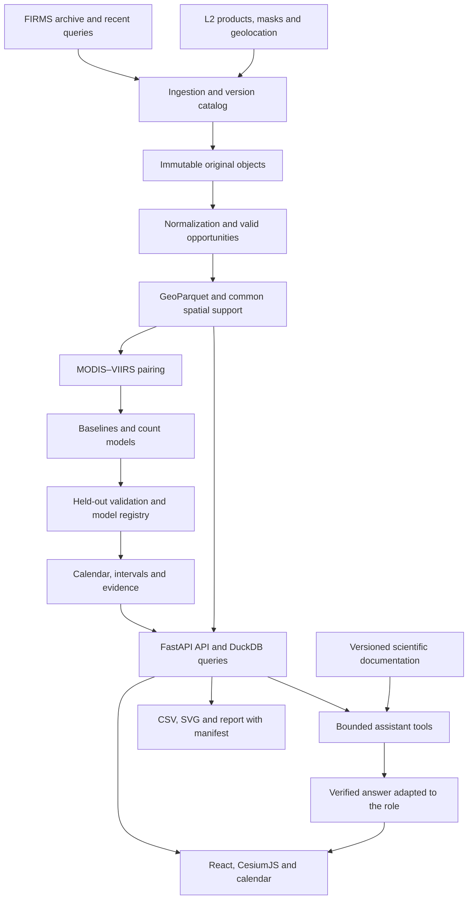

# NINA — Product, data and artificial intelligence architecture

**Implementation 0.2 available:** [startup and usage](../README.md), [scientific and technical status](STATUS_V2.md). The viewer uses CesiumJS, with global navigation, instrument comparison and selective acquisition by area/month. FastAPI/React/DuckDB and the local jobs remain; managed deployment and harmonization with observation opportunities are still pending.

**Proposed decision:** build a fire observatory with a harmonized calendar, a lab that demonstrates continuity between sensors and an assistant that explains results with evidence. The architecture raises the quality of the proposal by making its value verifiable; no stack guarantees winning.

**Current scope: global**, with archive availability and validation domain identified. Peru keeps its history and its test cases; a global NRT snapshot and one standard MODIS month for the Australian rectangle have already been downloaded. The initial Peruvian recommendation of 13 Nov was replaced by this direction. The full global history has not been downloaded and no planetary model has been validated.

The proposal is named **NINA**. This document specifies the architecture of the MODIS–VIIRS harmonization proposal and updates the earlier name. The full challenge statement provided by the team is in [the local copy](exa-results/nasa-space-apps-2026-2026-11-12/enunciado-a.txt). On 13 Nov 2026 the team shared the [published resource linking to FIRMS](exa-results/nasa-space-apps-2026-2026-11-12/recursos-a-2026-11-13.md); the [DATA_SOURCES.md review](DATA_SOURCES.md) specifies products, corrections and pending gaps. The decisions are based on that statement, NASA's documentation and the earlier analysis, without using development dates as a constraint.

## 1. The product worth defending

**Promise:** "NINA turns observations from different satellites into a comparable history of fire and explains what evidence supports each conclusion."

The central question is: **does this territory show activity different from its history, or did our way of observing it change?** The calendar answers first; the lab lets you check it; the AI adapts the explanation to the user.

| User | Concrete job | Answer NINA delivers | Limit |
|---|---|---|---|
| Land manager or monitoring team | Review a period and decide where to deepen an assessment | Seasonal comparison, coverage, areas with sufficient evidence and a draft report | A hotspot anomaly does not confirm an emergency or determine where to deploy brigades |
| Scientist or geospatial analyst | Check whether the change survives instrument differences | Explicit reference, original observations, experiments, uncertainty and reproducible export | Harmonization does not automatically recover all unobserved fire |
| Communication lead | Explain what the data show | Summary with verified figures, sources, period and limitations | It does not attribute causes or turn pixels into individual fires |

Possible use by these organizations is a product hypothesis, not a confirmed collaboration. It must be validated with real users.

**Defensible difference from other teams:** show a sensor substitution test and a case where the system abstains. We do not know the other participants' proposals and cannot guarantee exclusivity. A reproducible validation, a clear experience and proven usefulness are arguments we can build.

## 2. The HTML demo you can already open

[Open nina-demo.html](../nina-demo.html). It is a single file with HTML, CSS, JavaScript, charts and built-in synthetic data. It works when opened directly in a browser; it needs no installation, account or connection for the interactions. Links to external documentation do require internet.

It includes:

- Three schematic pilot areas: Madre de Dios, Ucayali and Cusco.
- Month and year selection, and a calendar range between 2001 and 2025.
- Interactive calendar of equivalent, MODIS and VIIRS counts.
- Comparison with the median of the same month over the previous ten years, excluding the selected year. This demo requires at least five eligible years.
- Schematic map with detections and coverage; it shows a visual sample of points, while the export contains all synthetic rows of the month.
- Instrument comparison lab, without invented accuracy metrics.
- Low-coverage case in March 2021 and a deliberate absence of an equivalent estimate in 2001–2002, pending validation of the Terra–Aqua bridge.
- Assistant with guided questions, three roles, explanation of limits and a draft report.
- Downloads of series CSV, detections CSV, JSON manifest, SVG chart and TXT report, marked as a simulation.

**Actual state:** it is a functional user-experience prototype. All counts, points, coverage percentages, ranges and comparisons are simulated. No model was trained, no NASA observations were processed and the assistant uses local rules, not an LLM. The visual range has no calibrated probabilistic coverage. The 65% threshold and the five-year minimum are illustrative interface decisions, pending scientific validation. The areas are not official administrative boundaries.

In the connected version, the range will reach the latest verified available date and partial months will have their own treatment. Pending elements —drawable AOI, real data, inference, authentication and services— are described here without presenting them as implemented.

## 3. Chosen architecture

I would use **a modular application and a scientific job process**, kept in the same repository. Heavy processing runs outside web requests. The frontend queries prepared products and identifiable jobs.



### Components and why they are chosen

| Layer | Choice | Responsibility |
|---|---|---|
| Interface | React + TypeScript + Vite | Shared state of AOI, period and filters; accessibility; typed responses |
| Cartography | MapLibre GL JS; deck.gl when the volume justifies it | Drawable AOI, detection layers, coverage and scale-based aggregation |
| Calendar and charts | SVG with D3 for scales and interaction | Readable and exportable visuals; avoid loading a different library for each chart |
| API | FastAPI + Pydantic | Contract validation, queries, authorization, jobs, exports and assistant tools |
| Analytical engine | DuckDB with the spatial extension | Query GeoParquet filtering first by period, platform and partitions |
| Scientific data | Original files + GeoParquet; Zarr only for cubes that need it | Preserve provenance and allow partial reads without moving decades of points to the browser |
| Catalog and application | PostgreSQL + PostGIS | AOI, runs, permissions, metadata, job state and geometries; do not duplicate the whole observation archive there |
| Processing | Python, GDAL, rasterio, pyproj, Shapely, xarray and verified HDF4/NetCDF readers | Geolocation, masks, pairing, reprojection and aggregation |
| Harmonization model | Additive count model; Poisson as a base, negative binomial if there is overdispersion; boosting as a competitor | Estimate the count under the reference, calibrate uncertainty and establish support |
| Assistant | Swappable LLM, typed tools and documentation retrieval | Question interpretation and writing; computations stay in the scientific engine |
| Execution | Docker containers, job queue and idempotent identifiers | Reproduce locally and in the cloud; tolerate retries and separate compute from the interface |

MapLibre documents vector map rendering in the browser; DuckDB offers geospatial processing through its spatial extension. These are documented capabilities, not a NINA benchmark. [MapLibre](https://maplibre.org/maplibre-gl-js/docs/), [DuckDB Spatial](https://duckdb.org/docs/2.0/core_extensions/spatial/overview).

Versions will be pinned after testing end to end an HDF4 granule, a NetCDF-4 one, their geolocation and a spatial query. **Installing rasterio is not assumed to allow reading any HDF4 product**: driver support and product structure are verified inside the worker image. CPU or training tasks do not run inside the async request loop. [Concurrency and parallelism in FastAPI](https://fastapi.tiangolo.com/async/).

### Reference deployment

I would choose **AWS** to settle a single deployment route, without a scientific dependency on that provider:

- **S3 + CloudFront:** static frontend, scientific objects, expiring exports and precomputed tiles. Permanent scientific manifests are kept with the analysis; they do not expire with the download link.
- **ECS/Fargate:** one API service and workers per job type. Large training could move to higher-capacity tasks keeping the same image and contract.
- **RDS PostgreSQL/PostGIS:** catalog, AOI, state, authorizations and run results.
- **SQS:** queue with retries and a dead-letter queue; a run has an idempotent key so that a retry does not publish two different results.
- **Secrets Manager and run logs:** NASA and AI-provider credentials on the server; job metrics, errors and costs per analysis.

This deployment is an engineering decision, not infrastructure created in this delivery. The hosting region and resource size are set according to data access conditions, latency for Peruvian users and a memory/time benchmark. Costs and performance are not presented as already measured.

For local development: Docker Compose with API, worker, PostgreSQL and S3-compatible storage, or local folders through the same adapter. I would not add Kubernetes, Kafka, a separate vector database or multiple conversational agents to the MVP: there is no measured need yet that would justify operating them.

## 4. Data and traceability

### Inputs

| Input | What it is used for | Treatment |
|---|---|---|
| FIRMS MODIS and VIIRS archive | Detection history | Import by platform, collection, version and period; keep standard and provisional processing as distinguishable revisions |
| FIRMS Area API | Adding bounded recent periods | Server-side access with MAP_KEY, limits and cache; do not rebuild decades with small calls |
| MOD14 / MYD14 and the VIIRS family VNP14IMG / VJ114IMG / VJ214IMG | Masks and observation attributes for the scientific method | Adapters per product and version, plus the geolocation and auxiliary layers their specification requires |
| AOI and cartography | Bound queries and communicate results | Polygons with provenance and license; the demo's pilot areas are replaced by verified geometries |
| Land cover or environmental context | Stratification and bias diagnosis | Add only if it improves validation; record epoch, resolution and definition |

The Area API documents queries by bounding box, sources and date; it requires a MAP_KEY and allows between one and five days per query. [Official FIRMS API](https://firms.modaps.eosdis.nasa.gov/api/area/). MOD14 C6.1 is distributed as HDF4 and VNP14IMG C2 as NetCDF-4. [MOD14](https://www.earthdata.nasa.gov/data/catalog/lpcloud-mod14-061), [VNP14IMG](https://www.earthdata.nasa.gov/data/catalog/lpcloud-vnp14img-002).

Continuity must not be designed around a single VIIRS platform: the VNP14IMG page announces the end of S-NPP science delivery on 2 November 2026 and recommends NOAA-21 and NOAA-20 products. Each bridge between platforms needs its own evaluation. This is a condition of the data supply, not a deadline for developing NINA. [Product notice](https://www.earthdata.nasa.gov/data/catalog/lpcloud-vnp14img-002).

### Four states the architecture must preserve

1. **Valid observation with detection.** There is a positive signal from the product.
2. **Valid observation without detection.** There is an observed opportunity and a zero that can be interpreted under its conditions.
3. **No valid observation.** Clouds, no overpass, data error or another explicit cause.
4. **Estimate without sufficient support.** There are inputs, but the model or the comparison is not validated for those conditions.

A CSV of positive points alone does not contain everything needed to distinguish these states. Masks and opportunities are a central part of the scientific product; the absence of a FIRMS row is not automatically turned into a zero. [FIRMS limitations](https://www.earthdata.nasa.gov/data/tools/firms/faq).

### Organization and revisions

```text
raw/{product}/{collection}/{platform}/{year}/{granule_id}
normalized/{schema_version}/{platform}/{year}/{month}/{spatial_partition}.parquet
opportunities/{schema_version}/{reference_grid}/{year}/{month}/...
models/{model_version}/model + configuration + model_card + evaluation
analyses/{analysis_id}/selection + calendar + diagnostics + evidence_manifest
```

Each original object is identified by URL/ID, product, version, acquisition and retrieval date, checksum and license. Ingestion is idempotent. When standard processing arrives that replaces a provisional observation, a revision is created and the affected aggregates are recomputed; the manifest that explains any previously published figure is kept.

Duplicate records and technical overlaps are removed according to documented rules. **Neighboring pixels are not collapsed into a "fire"**: several pixels of a front and several observation opportunities are different entities. The platform combination policy avoids multiplying the sampling when another satellite is added.

## 5. Scientific core and the first useful AI

### What is estimated

**Expected count of pixels with detection under a reference instrument and sampling protocol**, initially MODIS Aqua C6.1. It is shown as **equivalent hotspots**, separate from the raw counts. It can be fractional because it is an estimated expectation.

Initial unit: **equal-area cell × observation opportunity × local-time stratum**. Testing a 5 km grid with sensitivity at 2.5 and 10 km is an experimental decision; it does not mean offering a validated physical precision of 5 km. Computation geometry uses equal area and visualization uses geographic coordinates. UTC is stored, along with the solar/local time needed for pairing and the civil zone chosen for the user's months; in Peru, that zone is declared explicitly.

### Training

1. Build eligible pairs in the MODIS–VIIRS overlap with comparable spatial intersection, time window, quality and exposure. Record the window and check sensitivity; overpasses are not simultaneous.
2. Include zeros from valid opportunities. Keep unobserved opportunities as unknown.
3. Fit a **scale-factor baseline**, another simple count model and an **additive count model** with platform, season, geometry, quality and VIIRS signals. Evaluate exposure as an offset only if its proportionality assumption is compatible with the data.
4. Compare with **gradient boosting for counts**. Promote it only if it improves out of sample without degrading calibration, extremes or stability. Do not train a deep network by default: the added value must be demonstrated.
5. Estimate per reference unit and aggregate over non-overlapping units, with rules for AOI intersection and opportunity selection. Do not add duplicated predictions from several platforms for the same target opportunity.
6. If there is no support, emit `null` and a reason. Do not extrapolate a pre-Aqua series or another VIIRS platform without validating its bridge.

The learned relation can be written as `E[count_MODIS_reference | VIIRS_signals, quality, geometry, season, context]`. **MODIS is the instrument reference, not the complete truth of fire.** A useful predictive relation does not imply causal identification or recovery of hotspots hidden by clouds.

The architecture keeps the recent VIIRS detail in a separate layer. Reducing all detections to the effective resolution of the reference would lose information useful for exploring the territory.

### Uncertainty, coverage and partial months

- Distinguish the **interval of the expected mean** from the **predictive interval of counts**. The contract states which one is offered, its level and the calibration procedure.
- Propagate the dependence between units when aggregating. Adding the lower and upper bounds of individual intervals does not automatically produce a valid monthly interval. Use block/episode resampling or another validated procedure for the final scale.
- Compare over a common support or with a validated exposure standardization. A partial total is not labeled as the total of the whole territory.
- Clouds can be related to the phenomenon; a mechanical division by coverage percentage does not guarantee correcting the bias.
- For the current month, compare the same elapsed days and compatible opportunities, or declare the comparison provisional/unavailable. Do not compare ten recent days with complete historical months.
- Use the median of the same month and the eligible historical distribution, without including the evaluated period. If the median is zero, present the absolute difference and context; avoid infinite percentages.
- Record the history size and sensitivity to the choice of period. "Above the median" does not mean "statistically exceptional".

### The main test for the jury

**Substitution experiment:** hold out a region and a period with MODIS and VIIRS; hide MODIS for inference; rebuild the reference count from VIIRS; reveal MODIS only to evaluate. The simple baseline and the model use exactly the same partitions.

Measure absolute error, bias by season/platform/coverage, count deviance, interval calibration and preservation of extreme episodes. Hold out whole years and regions and block nearby episodes to avoid leakage. Add comparison of series and anomalies, not only fit of individual points. A validation against MODIS measures fidelity to MODIS; independent evidence serves to investigate usefulness and failures, and is not simply interchanged with that reference.

**Advancement criterion:** the complex method is only adopted if it brings a stable improvement over the baseline and has defensible uncertainty and limits. If it does not improve, NINA keeps the simple method and communicates the result. Version 0.1 already has real metrics for exploratory count calibration; they do not yet constitute a validation of the observation-controlled method described here. See [STATUS_V1.md](STATUS_V1.md).

## 6. The second useful AI: an assistant with tools and evidence

The assistant is part of the analysis flow, with four priority functions:

| Function | User example | Tools and delivery |
|---|---|---|
| Turn a question into a query | "Compare September in this area with its history" | Resolve AOI and period; return a visible structured query and run it |
| Explain a difference | "Is the increase due to the sensor?" | Query the instrument comparison and validation state; explain what can and cannot be separated |
| Assess sufficiency | "Can I use this comparison?" | Read coverage, support, revisions and quality; state limits or abstain |
| Prepare a report | "I need a summary for the land team" | Write from the identified analysis, with sources, verified figures and questions for human review |

### Exact flow

```text
Question and role + selected analysis
    → LLM proposes intent and parameters with a strict schema
    → API validates AOI, dates, limits and permissions
    → deterministic tools query the analysis
    → retrieval of versioned documentation, if needed
    → LLM writes claims linked to evidence_id
    → verifier checks figures, units, references and support state
    → interface shows the answer, sources and available actions
```

Allowed tools, for example:

```text
get_calendar(analysis_id)
compare_period(analysis_id, reference_period)
get_observation_quality(analysis_id)
get_sensor_validation(model_version, region_id)
retrieve_method_document(source_id, topic)
prepare_brief(analysis_id, audience, language)
```

The assistant **does not run free SQL, arbitrary Python or write a numeric prediction on its own**. If the question changes region or date, it creates or retrieves a new analysis and shows that selection; it does not answer with the previous analysis. The API enforces permissions independently of the model's instructions.

Figures are inserted from identified fields of the result. A structured claim can be `{kind: "historical_comparison", evidence_id, value_ref, baseline_ref, limitations}`. The server checks that the references exist and that the units match. For a bulletin, the final text is composed with those verified values. If a claim fails the check, it is removed or replaced by a deterministic template.

**Document retrieval:** start with a small corpus of NASA documentation, the method card and the model card, all versioned. Text search in PostgreSQL may be enough; add embeddings and `pgvector` only if the questions and evaluation show an improvement. Retrieving more text does not make an answer correct. Documents are untrusted evidence for instructing the system: they cannot extend tools, reveal secrets or change permissions.

**Model selection:** choose an LLM with tool calling and structured output through our own evaluation in Spanish and English and with remote-sensing terms. There is no need to fix a provider before that test. Compare faithfulness, abstention, latency, cost per report and data handling. Store the version, prompt, tools and references of each answer. The system keeps charts and template answers if the provider fails.

**What will not be offered as a proven capability:** spread prediction, causal detection of arson, evacuation prescriptions or automatic resource deployment. Those capabilities need different data, validation and users. The immediate benefit of AI is reducing interpretation time without losing the evidence.

### Assistant evaluation

Create a set of questions written with users: normal queries, AOI changes, partial-month comparison, unavailable sensor, zero median, few observations, out-of-scope question and false premises. Hold out a part without using it to modify prompts.

Check:

- Correct region/period query and allowed tools.
- Each figure, unit and source matches the analysis.
- No operational or causal claims without evidence.
- Abstention when appropriate, without hiding useful information that is available.
- User understanding, time to complete the task and corrections needed before sharing a report.

These are design criteria; performance has not been measured yet. A convincing summary with wrong figures is a failure, even if the text is well written.

## 7. Data and API contract

States are separated into distinct axes: **origin** (`observed`, `estimated`, `synthetic`), **processing** (`standard`, `provisional`) and **support** (`supported`, `insufficient`, `out_of_domain`, `bridge_pending`). An observation can be provisional without being synthetic; an estimate can have insufficient support.

| Entity | Minimum fields |
|---|---|
| `observation` | ID, product/platform/collection, granule, UTC, coordinates/footprint, quality, FRP with unit, processing and source checksum |
| `opportunity` | Cell, overpass, time stratum, valid fraction, mask, cause of absence, exposure and geometry |
| `pair` | Source/reference opportunities, temporal and spatial rule, pairing version and partition |
| `estimate` | Estimand, reference, value/unit, interval and type/level, support, coverage and model version |
| `analysis` | AOI, time zone, period, filters, reference period, data revision, state and idempotent key |
| `evidence` | Observation/model/code IDs, verifiable claims, sources and limits |
| `brief` | Analysis, role, language, LLM/prompt version, tools run, claims and validations |

```text
POST /v1/analyses                      → 202 + analysis_id, or an already computed analysis
GET  /v1/analyses/{id}                 → state and manifest of the selection
GET  /v1/analyses/{id}/calendar        → values, baseline, states and units
GET  /v1/analyses/{id}/quality         → support and observation diagnosis
GET  /v1/analyses/{id}/evidence        → references and provenance
GET  /v1/analyses/{id}/tiles/{z}/{x}/{y} → derived layer limited by scale
POST /v1/analyses/{id}/exports        → export job
GET  /v1/jobs/{job_id}                → pending/running/complete/failed
POST /v1/assistant/messages           → answer with analysis and references
GET  /v1/models/{version}/validation  → real benchmark results
```

The cache key includes normalized geometry, time zone, period, filters, protocol, model, baseline and data revision. The client does not reimplement a second silent version of the statistics. DuckDB opens analytical files read-only per process; PostgreSQL handles concurrent catalog writes. Computed products are published through a complete manifest, never as a partially updated folder.

The detections export contains **observed geolocations** from the real product. The series contains **aggregated estimates**. No synthetic coordinates are generated from an equivalent count to be presented as NASA hotspots. The demo coordinates are explicitly marked as synthetic.

## 8. Experience, performance and operation

The main path is **select territory → read calendar → compare month → review support → obtain evidence**. The user reaches the lab and the methodology when they need to dig deeper; the initial interface keeps few indicators and clear texts.

- National and per-administrative-division monthly precomputation, plus per-cell aggregates; spatial query of a custom AOI from the appropriate support.
- Filtering and aggregation on the server. Tiles/aggregates in overview; details at higher zoom with explicit limits. The browser does not receive the full archive.
- Accessible sequential palette, patterns and text for missing data, keyboard navigation and table/export as an alternative to color.
- Maps with source and license. A tile package for Peru can be distributed; do not use a demo map service as a production dependency without checking its terms.
- Show acquisition date and update date separately; distinguish "recent", "provisional" and "validated".
- Limits on area, time range, export size, memory and time per job. Large tasks go to a queue and have progress and cancellation.
- Credentials only on the server. Private AOIs and bulletins require permissions; the model cannot extend those permissions or publish a report by itself.
- Logging of failures, latency per endpoint, time/memory per job, data revision, model and AI cost. Backups and restore tests for catalog and manifests.

**Experience goals to measure:** filters that do not block the interface, a precomputed calendar that appears within a few seconds and a short explanation that arrives without preventing data exploration. Numeric goals will be set after measuring the pilot case size and connection conditions; performance is not attributed to undeployed infrastructure.

## 9. What must be complete to call the scientific version an MVP

The HTML demonstrates the experience. The **connected scientific MVP** must complete a vertical slice of the product:

1. Coverage of all of Peru, with national, department/region and polygon selection; evaluation on held-out regions and periods with diverse coast, highlands and rainforest conditions.
2. Reproducible ingestion of the national MODIS history and the selected VIIRS platforms (S-NPP, NOAA-20 and NOAA-21 depending on availability), plus the masks/geolocation the method requires.
3. Simple method and candidate model compared on a held-out evaluation.
4. Calendar of equivalent hotspots with coverage, absence states, same-month history and accessible originals.
5. Web with AOI, period, comparison, exports and a reproducible record.
6. Assistant that runs queries and summaries with references, plus a template fallback.
7. Sensor substitution test, low-coverage test and a demonstration of at least one real limitation.
8. Task review with users and scientific review of the meaning of the indicators.

To fully meet the ambition of the challenge, continuity will be extended to the early 2000s through the validated Terra–Aqua bridge, the relevant VIIRS platforms will be added and the latest availability will be shown. While a part is not validated, the interface must show that gap instead of filling the series artificially.

## 10. The demonstration I would propose to present

**Opening:** "Two satellites can count the same territory differently. How do we know whether the fire changed or our observation changed?"

1. Choose a real Peruvian case and a month; show raw counts and explain their instrument difference.
2. Open the reference calendar and compare with the historical median, stating coverage and uncertainty.
3. Open the held-out experiment: simple method, model, result and a failure. The quantitative evidence already obtained must be visible here.
4. Ask the assistant what can be claimed for a specific role. Follow a reference to the result that supports the sentence.
5. Switch to a case with insufficient support; show the abstention and finish by downloading the record.

Do not use synthetic figures from the HTML as results of that scientific presentation. The current demo serves to agree on design, language and flow before connecting data. NINA's argument will be the combination of **verifiable continuity, understanding and traceability**, with impact evaluated together with users.

## 11. References and verification scope

- [Statement provided by the team](exa-results/nasa-space-apps-2026-2026-11-12/enunciado-a.txt): harmonized calendar, spatial/temporal selection, historical comparison and downloads.
- [Earlier research, updated to the NINA name](exa-results/nasa-space-apps-2026-2026-11-12/informe.md): background, methodology and limitations.
- [FIRMS archive](https://firms.modaps.eosdis.nasa.gov/download/): historical detections.
- [FIRMS Area API](https://firms.modaps.eosdis.nasa.gov/api/area/): query contract and access.
- [FIRMS FAQ](https://www.earthdata.nasa.gov/data/tools/firms/faq): interpretation and limits.
- [MOD14 C6.1](https://www.earthdata.nasa.gov/data/catalog/lpcloud-mod14-061) and [VNP14IMG C2](https://www.earthdata.nasa.gov/data/catalog/lpcloud-vnp14img-002): product format and characteristics.
- [MapLibre GL JS](https://maplibre.org/maplibre-gl-js/docs/): cartographic capabilities.
- [DuckDB Spatial](https://duckdb.org/docs/2.0/core_extensions/spatial/overview): spatial extension.
- [FastAPI: concurrency and parallelism](https://fastapi.tiangolo.com/async/): separation between service and compute.

The architecture choices and experimental criteria are NINA's proposals, not requirements attributed to NASA. The product, API and technical documentation pages were cross-checked during this review. In 0.1 the detection pipeline, the exploratory benchmark and the local service were run; harmonization with valid opportunities, evaluation of a real LLM and cloud deployment keep their pending states.
