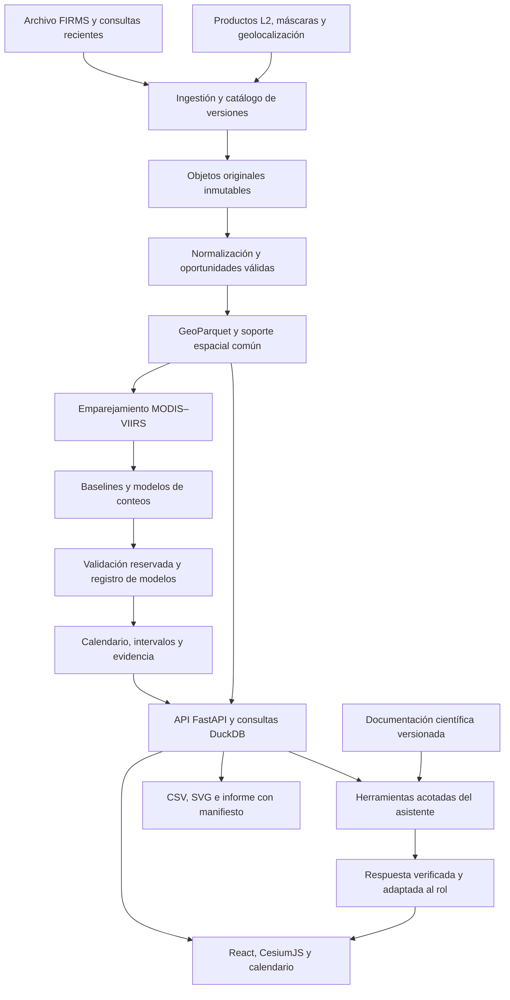

# NINA — Arquitectura de producto, datos e inteligencia artificial

**Implementación 0.2 disponible:** [arranque y uso](../README.md), [estado científico y técnico](ESTADO_V2.md). El visor usa CesiumJS, con navegación mundial, comparación instrumental y adquisición selectiva por área/mes. FastAPI/React/DuckDB y los trabajos locales permanecen; el despliegue administrado y la armonización con oportunidades de observación siguen pendientes.

**Decisión propuesta:** construir un observatorio del fuego con un calendario armonizado, un laboratorio que demuestre la continuidad entre sensores y un asistente que explique resultados con evidencia. La arquitectura aumenta la calidad de la propuesta al hacer verificable su valor; ningún stack garantiza ganar.

**Alcance vigente: mundial**, con disponibilidad del archivo y dominio de validación identificados. Perú conserva su histórico y sus casos de prueba; ya se descargaron una instantánea mundial NRT y un mes MODIS estándar del rectángulo australiano. La recomendación inicial peruana del 13-nov fue sustituida por esta dirección. No se ha descargado todo el histórico mundial ni validado un modelo planetario.

El nombre de la propuesta es **NINA**. Este documento concreta la arquitectura de la propuesta de armonización MODIS–VIIRS y actualiza la denominación anterior. El enunciado completo facilitado por el equipo está en [la copia local](exa-results/nasa-space-apps-2026-2026-11-12/enunciado-a.txt). El 13-nov-2026 el equipo compartió el [recurso publicado que enlaza a FIRMS](exa-results/nasa-space-apps-2026-2026-11-12/recursos-a-2026-11-13.md); la [revisión de DATA_SOURCES.md](DATA_SOURCES.md) concreta productos, correcciones y brechas pendientes. Las decisiones se basan en ese enunciado, la documentación de NASA y el análisis anterior, sin usar fechas de desarrollo como restricción.

## 1. El producto que merece defenderse

**Promesa:** «NINA convierte observaciones de satélites diferentes en una historia del fuego comparable y explica qué evidencia respalda cada conclusión».

La pregunta central es: **¿este territorio muestra una actividad distinta de su historia, o cambió nuestra forma de observarlo?** El calendario responde primero; el laboratorio permite comprobarlo; la IA adapta la explicación al usuario.

| Usuario | Trabajo concreto | Respuesta que entrega NINA | Límite |
|---|---|---|---|
| Gestor territorial o equipo de monitoreo | Revisar un período y decidir dónde profundizar una evaluación | Comparación estacional, cobertura, áreas con evidencia suficiente y borrador de informe | Una anomalía de focos no confirma una emergencia ni determina dónde desplegar brigadas |
| Científico o analista geoespacial | Comprobar si el cambio sobrevive a diferencias instrumentales | Referencia explícita, observaciones originales, experimentos, incertidumbre y exportación reproducible | La armonización no recupera automáticamente todo el fuego no observado |
| Responsable de comunicación | Explicar qué muestran los datos | Resumen con cifras verificadas, fuentes, período y limitaciones | No atribuye causas ni convierte píxeles en incendios individuales |

El posible uso por estas organizaciones es una hipótesis de producto, no una colaboración ya confirmada. Debe validarse con usuarios reales.

**Diferencia defendible ante otros equipos:** enseñar una prueba de sustitución del sensor y un caso en el que el sistema se abstiene. No conocemos las propuestas de los demás participantes ni podemos asegurar exclusividad. Una validación reproducible, una experiencia clara y una utilidad comprobada son argumentos que sí podemos construir.

## 2. La demo HTML que ya puedes abrir

[Abrir nina-demo.html](../nina-demo.html). Es un único archivo con HTML, CSS, JavaScript, gráficos y datos sintéticos incorporados. Funciona abriéndolo directamente en un navegador; no necesita instalación, cuenta ni conexión para las interacciones. Los enlaces a documentación externa sí requieren internet.

Incluye:

- Tres áreas piloto esquemáticas: Madre de Dios, Ucayali y Cusco.
- Selección de mes y año, y rango del calendario entre 2001 y 2025.
- Calendario interactivo de conteos equivalentes, MODIS y VIIRS.
- Comparación con la mediana del mismo mes de los diez años anteriores, excluyendo el año seleccionado. Exige al menos cinco años elegibles en esta demostración.
- Mapa esquemático con detecciones y cobertura; muestra una muestra visual de puntos, mientras la exportación contiene todas las filas sintéticas del mes.
- Laboratorio de comparación instrumental, sin métricas de precisión inventadas.
- Caso de baja cobertura en marzo de 2021 y ausencia deliberada de estimación equivalente en 2001–2002, a la espera de validar el puente Terra–Aqua.
- Asistente con preguntas guiadas, tres roles, explicación de límites y borrador de informe.
- Descargas de serie CSV, detecciones CSV, manifiesto JSON, gráfico SVG e informe TXT, marcadas como simulación.

**Estado real:** es un prototipo funcional de experiencia de usuario. Todos los conteos, puntos, porcentajes de cobertura, rangos y comparaciones son simulados. No se entrenó un modelo, no se procesaron observaciones NASA y el asistente usa reglas locales, no un LLM. El rango visual no tiene cobertura probabilística calibrada. El umbral del 65% y el mínimo de cinco años son decisiones ilustrativas de interfaz, pendientes de validación científica. Las áreas no son límites administrativos oficiales.

En la versión conectada, el rango llegará hasta la última fecha disponible verificada y los meses parciales tendrán tratamiento propio. Los elementos pendientes —AOI dibujable, datos reales, inferencia, autenticación y servicios— se describen aquí sin presentarlos como implementados.

## 3. Arquitectura elegida

Usaría **una aplicación modular y un proceso de trabajos científicos**, mantenidos en un mismo repositorio. El procesamiento pesado se ejecuta fuera de las peticiones de la web. El frontend consulta productos preparados y trabajos identificables.



### Componentes y por qué se eligen

| Capa | Elección | Responsabilidad |
|---|---|---|
| Interfaz | React + TypeScript + Vite | Estado compartido de AOI, período y filtros; accesibilidad; tipado de respuestas |
| Cartografía | MapLibre GL JS; deck.gl cuando el volumen lo justifique | AOI dibujable, capas de detecciones, cobertura y agregaciones por escala |
| Calendario y gráficos | SVG con D3 para escalas e interacción | Visuales legibles y exportables; evitar cargar una biblioteca distinta por cada gráfico |
| API | FastAPI + Pydantic | Validación del contrato, consultas, autorización, trabajos, exportaciones y herramientas del asistente |
| Motor analítico | DuckDB con extensión espacial | Consultar GeoParquet filtrando antes por período, plataforma y particiones |
| Datos científicos | Archivos originales + GeoParquet; Zarr solo para cubos que lo requieran | Preservar procedencia y permitir lectura parcial sin trasladar décadas de puntos al navegador |
| Catálogo y aplicación | PostgreSQL + PostGIS | AOI, ejecuciones, permisos, metadatos, estado de trabajos y geometrías; no duplicar allí todo el archivo de observaciones |
| Procesamiento | Python, GDAL, rasterio, pyproj, Shapely, xarray y lectores HDF4/NetCDF verificados | Geolocalización, máscaras, emparejamiento, reproyección y agregación |
| Modelo de armonización | Modelo aditivo de conteos; Poisson de base, binomial negativa si hay sobredispersión; boosting como competidor | Estimar el conteo bajo la referencia, calibrar incertidumbre y establecer soporte |
| Asistente | LLM intercambiable, herramientas tipadas y recuperación de documentación | Interpretación de preguntas y redacción; los cálculos permanecen en el motor científico |
| Ejecución | Contenedores Docker, cola de trabajos e identificadores idempotentes | Reproducir local y cloud; tolerar reintentos y separar cómputo de la interfaz |

MapLibre documenta renderizado de mapas vectoriales en el navegador; DuckDB ofrece procesamiento geoespacial mediante su extensión espacial. Son capacidades documentadas, no un benchmark de NINA. [MapLibre](https://maplibre.org/maplibre-gl-js/docs/), [DuckDB Spatial](https://duckdb.org/docs/2.0/core_extensions/spatial/overview).

Se fijarán versiones después de probar de extremo a extremo un gránulo HDF4, un NetCDF-4, su geolocalización y una consulta espacial. **No se asume que instalar rasterio permita leer cualquier producto HDF4**: el soporte de drivers y la estructura del producto se verifican dentro de la imagen del worker. Las tareas de CPU o entrenamiento no se ejecutan dentro del bucle de peticiones asíncronas. [Concurrencia y paralelismo en FastAPI](https://fastapi.tiangolo.com/async/).

### Despliegue de referencia

Elegiría **AWS** para concretar una única ruta de despliegue, sin dependencia científica de ese proveedor:

- **S3 + CloudFront:** frontend estático, objetos científicos, exportaciones con caducidad y teselas precalculadas. Los manifiestos científicos permanentes se conservan con el análisis; no caducan con el enlace de descarga.
- **ECS/Fargate:** un servicio de API y workers por tipo de trabajo. El entrenamiento grande podría trasladarse a tareas de mayor capacidad conservando la misma imagen y contrato.
- **RDS PostgreSQL/PostGIS:** catálogo, AOI, estado, autorizaciones y resultados de ejecuciones.
- **SQS:** cola con reintentos y cola de fallos; una ejecución tiene una clave idempotente para que un reintento no publique dos resultados distintos.
- **Secrets Manager y registros de ejecución:** credenciales de NASA y del proveedor de IA en servidor; métricas de trabajos, errores y costes por análisis.

Este despliegue es una decisión de ingeniería, no infraestructura creada en esta entrega. La región de alojamiento y el tamaño de los recursos se fijan según condiciones de acceso a los datos, latencia para usuarios peruanos y benchmark de memoria/tiempo. No se presentan costes ni rendimiento como ya medidos.

Para desarrollo local: Docker Compose con API, worker, PostgreSQL y almacenamiento compatible con S3, o carpetas locales mediante el mismo adaptador. No incorporaría Kubernetes, Kafka, una base vectorial independiente ni múltiples agentes conversacionales en el MVP: no hay todavía una necesidad medida que compense su operación.

## 4. Datos y trazabilidad

### Entradas

| Entrada | Para qué se utiliza | Tratamiento |
|---|---|---|
| Archivo FIRMS MODIS y VIIRS | Historial de detecciones | Importación por plataforma, colección, versión y período; conservar procesamiento estándar y provisional como revisiones distinguibles |
| FIRMS Area API | Incorporación de períodos recientes acotados | Acceso desde servidor con MAP_KEY, límites y caché; no reconstruir décadas con llamadas pequeñas |
| MOD14 / MYD14 y familia VIIRS VNP14IMG / VJ114IMG / VJ214IMG | Máscaras y atributos de observación para el método científico | Adaptadores por producto y versión, más geolocalización y capas auxiliares que exija su especificación |
| AOI y cartografía | Delimitar consultas y comunicar resultados | Polígonos con procedencia y licencia; las áreas piloto de la demo se sustituyen por geometrías verificadas |
| Cobertura del suelo o contexto ambiental | Estratificación y diagnóstico del sesgo | Añadir únicamente si mejora la validación; registrar época, resolución y definición |

La Area API documenta consultas por caja geográfica, fuentes y fecha; requiere MAP_KEY y permite entre uno y cinco días por consulta. [API oficial FIRMS](https://firms.modaps.eosdis.nasa.gov/api/area/). MOD14 C6.1 se distribuye como HDF4 y VNP14IMG C2 como NetCDF-4. [MOD14](https://www.earthdata.nasa.gov/data/catalog/lpcloud-mod14-061), [VNP14IMG](https://www.earthdata.nasa.gov/data/catalog/lpcloud-vnp14img-002).

No se debe diseñar la continuidad alrededor de una sola plataforma VIIRS: la página de VNP14IMG anuncia el cese de entrega científica de S-NPP el 2 de noviembre de 2026 y recomienda productos NOAA-21 y NOAA-20. Cada puente entre plataformas necesita evaluación propia. Esto es una condición del suministro de datos, no un plazo para desarrollar NINA. [Aviso del producto](https://www.earthdata.nasa.gov/data/catalog/lpcloud-vnp14img-002).

### Cuatro estados que la arquitectura debe preservar

1. **Observación válida con detección.** Existe una señal positiva del producto.
2. **Observación válida sin detección.** Existe una oportunidad observada y un cero interpretable bajo sus condiciones.
3. **Sin observación válida.** Nubes, ausencia de pasada, error de datos u otra causa explícita.
4. **Estimación sin soporte suficiente.** Hay entradas, pero el modelo o la comparación no están validados para esas condiciones.

Un CSV de puntos positivos no contiene por sí solo todo lo necesario para distinguir estos estados. Las máscaras y oportunidades son parte central del producto científico; la ausencia de una fila de FIRMS no se convierte automáticamente en cero. [Limitaciones de FIRMS](https://www.earthdata.nasa.gov/data/tools/firms/faq).

### Organización y revisiones

```text
raw/{product}/{collection}/{platform}/{year}/{granule_id}
normalized/{schema_version}/{platform}/{year}/{month}/{spatial_partition}.parquet
opportunities/{schema_version}/{reference_grid}/{year}/{month}/...
models/{model_version}/model + configuration + model_card + evaluation
analyses/{analysis_id}/selection + calendar + diagnostics + evidence_manifest
```

Cada objeto original se identifica por URL/ID, producto, versión, fecha de adquisición y recuperación, checksum y licencia. La ingestión es idempotente. Al llegar procesamiento estándar que reemplace una observación provisional, se crea una revisión y se recalculan los agregados afectados; se conserva el manifiesto que explica cualquier cifra previamente publicada.

Se eliminan registros duplicados y solapamientos técnicos según reglas documentadas. **No se colapsan píxeles vecinos en un “incendio”**: varios píxeles de un frente y varias oportunidades de observación son entidades diferentes. La política de combinación de plataformas evita multiplicar el muestreo al incorporar otro satélite.

## 5. Núcleo científico y primera IA útil

### Qué se estima

**Conteo esperado de píxeles con detección bajo un protocolo instrumental y de muestreo de referencia**, inicialmente MODIS Aqua C6.1. Se muestra como **focos equivalentes**, separado de los conteos brutos. Puede ser fraccionario porque es una expectativa estimada.

Unidad inicial: **celda de área equivalente × oportunidad de observación × estrato de hora local**. Probar una malla de 5 km y sensibilidad a 2,5 y 10 km es una decisión experimental; no significa ofrecer una precisión física de 5 km validada. La geometría de cálculo usa área equivalente y la visualización coordenadas geográficas. Se almacena UTC, hora solar/local necesaria para el emparejamiento y la zona civil elegida para los meses del usuario; en Perú, esa zona se declara explícitamente.

### Entrenamiento

1. Construir pares elegibles en el solapamiento MODIS–VIIRS con intersección espacial, ventana temporal, calidad y exposición comparables. Registrar la ventana y comprobar sensibilidad; las pasadas no son simultáneas.
2. Incorporar ceros de oportunidades válidas. Conservar como desconocidas las oportunidades no observadas.
3. Ajustar un **baseline de factor de escala**, otro modelo simple de conteos y un **modelo aditivo de conteos** con plataforma, estación, geometría, calidad y señales VIIRS. Evaluar exposición como offset únicamente si su supuesto de proporcionalidad es compatible con los datos.
4. Comparar con **gradient boosting para conteos**. Promoverlo solo si mejora fuera de muestra sin degradar calibración, extremos o estabilidad. No entrenar por defecto una red profunda: el incremento de valor debe demostrarse.
5. Estimar por unidad de referencia y agregar sobre unidades no solapadas, con reglas de intersección de AOI y de selección de oportunidades. No sumar predicciones duplicadas de varias plataformas para la misma oportunidad objetivo.
6. Si no hay soporte, emitir `null` y un motivo. No extrapolar una serie pre-Aqua ni otra plataforma VIIRS sin validar su puente.

La relación aprendida se puede expresar como `E[conteo_MODIS_referencia | señales_VIIRS, calidad, geometría, estación, contexto]`. **MODIS es la referencia instrumental, no la verdad completa del fuego.** Una relación predictiva útil no implica identificación causal ni recuperación de focos ocultos por nubes.

La arquitectura conserva el detalle reciente de VIIRS en una capa separada. Reducir todas las detecciones a la resolución efectiva de la referencia perdería información útil para explorar el territorio.

### Incertidumbre, cobertura y meses parciales

- Distinguir **intervalo de la media esperada** de **intervalo predictivo de conteos**. El contrato declara cuál se ofrece, su nivel y el procedimiento de calibración.
- Propagar la dependencia entre unidades al agregar. Sumar límites inferiores y superiores de intervalos individuales no produce automáticamente un intervalo mensual válido. Usar remuestreo por bloques/episodios u otro procedimiento validado para la escala final.
- Comparar sobre un soporte común o con una estandarización de exposición validada. Un total parcial no se etiqueta como el total de todo el territorio.
- Las nubes pueden relacionarse con el fenómeno; una división mecánica por porcentaje de cobertura no garantiza corregir el sesgo.
- Para el mes en curso, comparar los mismos días transcurridos y oportunidades compatibles, o declarar la comparación provisional/no disponible. No comparar diez días recientes con meses históricos completos.
- Usar mediana del mismo mes y distribución histórica elegible, sin incluir el período evaluado. Si la mediana es cero, presentar diferencia absoluta y contexto; evitar porcentajes infinitos.
- Registrar tamaño del historial y sensibilidad a la elección del período. «Por encima de la mediana» no equivale a «estadísticamente excepcional».

### La prueba principal para el jurado

**Experimento de sustitución:** reservar una región y un período con MODIS y VIIRS; ocultar MODIS para la inferencia; reconstruir el conteo de referencia desde VIIRS; revelar MODIS únicamente para evaluar. El baseline simple y el modelo usan exactamente las mismas particiones.

Medir error absoluto, sesgo por estación/plataforma/cobertura, deviance de conteos, calibración de intervalos y conservación de episodios extremos. Reservar años y regiones completos y bloquear episodios cercanos para evitar fuga. Añadir comparación de series y anomalías, no solo ajuste de puntos individuales. Una validación contra MODIS mide fidelidad a MODIS; la evidencia independiente sirve para investigar utilidad y fallos, no se intercambia sin más con esa referencia.

**Criterio de avance:** el método complejo solo se adopta si aporta una mejora estable sobre el baseline y tiene incertidumbre y límites defendibles. Si no mejora, NINA conserva el método simple y comunica el resultado. La versión 0.1 ya tiene métricas reales de calibración exploratoria de conteos; no constituyen todavía una validación del método con control de observación descrito aquí. Véase [ESTADO_V1.md](ESTADO_V1.md).

## 6. Segunda IA útil: un asistente con herramientas y evidencia

El asistente es parte del flujo de análisis, con cuatro funciones prioritarias:

| Función | Ejemplo del usuario | Herramientas y entrega |
|---|---|---|
| Traducir una pregunta a una consulta | «Compara septiembre en esta área con su historia» | Resolver AOI y período; devolver una consulta estructurada visible y ejecutarla |
| Explicar una diferencia | «¿El aumento se debe al sensor?» | Consultar comparación instrumental y estado de validación; explicar qué puede y qué no puede separarse |
| Evaluar suficiencia | «¿Puedo usar esta comparación?» | Leer cobertura, soporte, revisiones y calidad; exponer límites o abstenerse |
| Preparar un informe | «Necesito un resumen para el equipo territorial» | Redactar a partir del análisis identificado, con fuentes, cifras verificadas y preguntas para revisión humana |

### Flujo exacto

```text
Pregunta y rol + análisis seleccionado
    → LLM propone intención y parámetros con esquema estricto
    → API valida AOI, fechas, límites y permisos
    → herramientas deterministas consultan el análisis
    → recuperación de documentación versionada, si hace falta
    → LLM redacta afirmaciones ligadas a evidence_id
    → verificador comprueba cifras, unidades, referencias y estado de soporte
    → interfaz muestra respuesta, fuentes y acciones disponibles
```

Herramientas permitidas, por ejemplo:

```text
get_calendar(analysis_id)
compare_period(analysis_id, reference_period)
get_observation_quality(analysis_id)
get_sensor_validation(model_version, region_id)
retrieve_method_document(source_id, topic)
prepare_brief(analysis_id, audience, language)
```

El asistente **no ejecuta SQL libre, Python arbitrario ni escribe una predicción numérica por su cuenta**. Si la pregunta cambia de región o de fecha, crea o recupera un análisis nuevo y muestra esa selección; no responde con el análisis anterior. La API aplica permisos independientemente de las instrucciones del modelo.

Las cifras se insertan desde campos identificados del resultado. Una afirmación estructurada puede ser `{kind: "historical_comparison", evidence_id, value_ref, baseline_ref, limitations}`. El servidor verifica que las referencias existan y que las unidades coincidan. Para un boletín, el texto final se compone con esos valores verificados. Si una afirmación falla la comprobación, se retira o se sustituye por una plantilla determinista.

**Recuperación documental:** comenzar con un corpus pequeño de documentación NASA, ficha del método y ficha del modelo, todos versionados. Búsqueda textual en PostgreSQL puede bastar; incorporar embeddings y `pgvector` solo si las preguntas y evaluación muestran una mejora. Recuperar más texto no convierte una respuesta en correcta. Los documentos son evidencia no confiable para dar instrucciones al sistema: no pueden ampliar herramientas, revelar secretos o cambiar permisos.

**Selección del modelo:** elegir un LLM con llamadas a herramientas y salida estructurada mediante una evaluación propia en español y términos de teledetección. No es necesario fijar un proveedor antes de esa prueba. Comparar fidelidad, abstención, latencia, coste por informe y tratamiento de datos. Guardar versión, prompt, herramientas y referencias de cada respuesta. El sistema conserva gráficos y respuestas por plantilla si el proveedor falla.

**Qué no se ofrecerá como capacidad probada:** predicción de propagación, detección causal de incendios provocados, prescripción de evacuaciones o despliegue automático de recursos. Esas capacidades necesitan datos, validación y usuarios distintos. El beneficio inmediato de IA es reducir el tiempo de interpretación sin perder la evidencia.

### Evaluación del asistente

Crear un conjunto de preguntas redactadas con usuarios: consultas normales, cambios de AOI, comparación de mes parcial, sensor no disponible, mediana cero, pocas observaciones, pregunta fuera de alcance y premisas falsas. Reservar una parte sin usarla para modificar prompts.

Comprobar:

- Consulta correcta de región/período y herramientas permitidas.
- Correspondencia de cada cifra, unidad y fuente con el análisis.
- Ausencia de afirmaciones operativas o causales sin evidencia.
- Abstención cuando corresponde, sin ocultar información útil que sí está disponible.
- Comprensión del usuario, tiempo para completar la tarea y correcciones necesarias antes de compartir un informe.

Los criterios son de diseño; todavía no se ha medido desempeño. Un resumen convincente con cifras incorrectas es un fallo, aunque el texto esté bien escrito.

## 7. Contrato de datos y API

Los estados se separan en ejes distintos: **origen** (`observed`, `estimated`, `synthetic`), **procesamiento** (`standard`, `provisional`) y **soporte** (`supported`, `insufficient`, `out_of_domain`, `bridge_pending`). Una observación puede ser provisional sin ser sintética; un estimado puede tener soporte insuficiente.

| Entidad | Campos mínimos |
|---|---|
| `observation` | ID, producto/plataforma/colección, gránulo, UTC, coordenadas/huella, calidad, FRP con unidad, procesamiento y checksum de origen |
| `opportunity` | Celda, pasada, estrato horario, fracción válida, máscara, causa de ausencia, exposición y geometría |
| `pair` | Oportunidades fuente/referencia, regla temporal y espacial, versión del emparejamiento y partición |
| `estimate` | Estimando, referencia, valor/unidad, intervalo y tipo/nivel, soporte, cobertura y versión de modelo |
| `analysis` | AOI, zona horaria, período, filtros, período de referencia, revisión de datos, estado y clave idempotente |
| `evidence` | IDs de observación/modelo/código, afirmaciones verificables, fuentes y límites |
| `brief` | Análisis, rol, idioma, versión del LLM/prompt, herramientas ejecutadas, afirmaciones y validaciones |

```text
POST /v1/analyses                      → 202 + analysis_id, o análisis ya calculado
GET  /v1/analyses/{id}                 → estado y manifiesto de la selección
GET  /v1/analyses/{id}/calendar        → valores, baseline, estados y unidades
GET  /v1/analyses/{id}/quality         → soporte y diagnóstico de observación
GET  /v1/analyses/{id}/evidence        → referencias y procedencia
GET  /v1/analyses/{id}/tiles/{z}/{x}/{y} → capa derivada y limitada por escala
POST /v1/analyses/{id}/exports        → trabajo de exportación
GET  /v1/jobs/{job_id}                → pendiente/en curso/completo/fallido
POST /v1/assistant/messages           → respuesta con análisis y referencias
GET  /v1/models/{version}/validation  → resultados reales del benchmark
```

La clave de caché incorpora geometría normalizada, zona horaria, período, filtros, protocolo, modelo, baseline y revisión de datos. El cliente no vuelve a implementar una segunda versión silenciosa de la estadística. DuckDB abre archivos analíticos de solo lectura por proceso; PostgreSQL gestiona escrituras concurrentes del catálogo. Los productos calculados se publican mediante un manifiesto completo, nunca como una carpeta parcialmente actualizada.

La exportación de detecciones contiene **geolocalizaciones observadas** en el producto real. La serie contiene **estimados agregados**. No se generan coordenadas sintéticas a partir de un conteo equivalente para presentarlas como focos NASA. Las coordenadas de la demo están expresamente marcadas como sintéticas.

## 8. Experiencia, rendimiento y operación

La ruta principal es **seleccionar territorio → leer calendario → comparar mes → revisar soporte → obtener evidencia**. El usuario accede al laboratorio y a la metodología cuando necesita profundizar; la interfaz inicial mantiene pocos indicadores y textos claros.

- Precálculo mensual nacional y por divisiones administrativas, más agregados por celda; consulta espacial de AOI personalizada a partir del soporte adecuado.
- Filtrado y agregación en servidor. Teselas/agregados en vistas generales; detalles a mayor zoom con límites explícitos. El navegador no recibe el archivo completo.
- Paleta secuencial accesible, patrones y texto para ausencia de datos, navegación por teclado y tabla/exportación como alternativa al color.
- Mapas con fuente y licencia. Se puede distribuir un paquete de teselas de Perú; no usar un servicio de mapas de demostración como dependencia de producción sin revisar sus condiciones.
- Mostrar fecha de adquisición y de actualización por separado; distinguir «reciente», «provisional» y «validado».
- Límites de área, rango temporal, tamaño de exportación, memoria y tiempo por trabajo. Las tareas grandes pasan a cola y tienen progreso y cancelación.
- Credenciales solo en servidor. AOI privados y boletines requieren permisos; el modelo no puede ampliar esos permisos ni publicar un informe por sí mismo.
- Registro de fallos, latencia por endpoint, tiempo/memoria por trabajo, revisión de datos, modelo y coste de IA. Copias de seguridad y prueba de restauración para catálogo y manifiestos.

**Objetivos de experiencia para medir:** filtros que no bloqueen la interfaz, calendario precalculado que aparezca en pocos segundos y una explicación breve que llegue sin impedir explorar los datos. Se fijarán objetivos numéricos después de medir tamaño del caso piloto y condiciones de conexión; no se atribuye rendimiento a infraestructura no desplegada.

## 9. Qué debe estar completo para llamar MVP a la versión científica

El HTML demuestra la experiencia. El **MVP científico conectado** debe completar una sección vertical del producto:

1. Cobertura de todo el Perú, con selección nacional, por departamento/región y por polígono; evaluación en regiones y períodos reservados con condiciones diversas de costa, sierra y selva.
2. Ingestión reproducible del historial nacional MODIS y de las plataformas VIIRS seleccionadas (S-NPP, NOAA-20 y NOAA-21 según disponibilidad), más las máscaras/geolocalización que requiera el método.
3. Método simple y modelo candidato comparados en evaluación reservada.
4. Calendario de focos equivalentes con cobertura, estados de ausencia, histórico del mismo mes y originales accesibles.
5. Web con AOI, período, comparación, exportaciones y expediente reproducible.
6. Asistente que haga consultas y resúmenes con referencias, más una alternativa por plantillas.
7. Prueba de sustitución del sensor, prueba de baja cobertura y demostración de al menos una limitación real.
8. Revisión de tareas con usuarios y revisión científica del significado de los indicadores.

Para cubrir plenamente la ambición del reto se extenderá la continuidad a principios de los 2000 mediante el puente Terra–Aqua validado, se incorporarán las plataformas VIIRS pertinentes y se mostrará la última disponibilidad. Mientras una parte no esté validada, la interfaz debe indicar esa brecha en lugar de completar la serie artificialmente.

## 10. La demostración que propondría presentar

**Inicio:** «Dos satélites pueden contar distinto el mismo territorio. ¿Cómo sabemos si cambió el fuego o cambió nuestra observación?»

1. Elegir un caso peruano real y un mes; mostrar conteos brutos y explicar su diferencia instrumental.
2. Abrir el calendario de referencia y comparar con la mediana histórica, indicando cobertura e incertidumbre.
3. Abrir el experimento reservado: método simple, modelo, resultado y un fallo. Aquí se debe ver la evidencia cuantitativa ya obtenida.
4. Preguntar al asistente qué puede afirmarse para un rol concreto. Seguir una referencia hasta el resultado que respalda la frase.
5. Cambiar a un caso de soporte insuficiente; mostrar la abstención y terminar descargando el expediente.

No usar cifras sintéticas del HTML como resultados de esa presentación científica. La demo actual sirve para acordar diseño, lenguaje y flujo antes de conectar datos. El argumento de NINA será la combinación de **continuidad comprobable, comprensión y trazabilidad**, con impacto evaluado junto a usuarios.

## 11. Referencias y alcance de verificación

- [Enunciado facilitado por el equipo](exa-results/nasa-space-apps-2026-2026-11-12/enunciado-a.txt): calendario armonizado, selección espacial/temporal, comparación histórica y descargas.
- [Investigación anterior, actualizada al nombre NINA](exa-results/nasa-space-apps-2026-2026-11-12/informe.md): antecedentes, metodología y limitaciones.
- [Archivo FIRMS](https://firms.modaps.eosdis.nasa.gov/download/): detecciones históricas.
- [Area API FIRMS](https://firms.modaps.eosdis.nasa.gov/api/area/): contrato de consulta y acceso.
- [FAQ FIRMS](https://www.earthdata.nasa.gov/data/tools/firms/faq): interpretación y límites.
- [MOD14 C6.1](https://www.earthdata.nasa.gov/data/catalog/lpcloud-mod14-061) y [VNP14IMG C2](https://www.earthdata.nasa.gov/data/catalog/lpcloud-vnp14img-002): formato y características de productos.
- [MapLibre GL JS](https://maplibre.org/maplibre-gl-js/docs/): capacidades cartográficas.
- [DuckDB Spatial](https://duckdb.org/docs/2.0/core_extensions/spatial/overview): extensión espacial.
- [FastAPI: concurrencia y paralelismo](https://fastapi.tiangolo.com/async/): separación entre servicio y cómputo.

Las elecciones de arquitectura y los criterios experimentales son propuestas de NINA, no requisitos atribuidos a NASA. Las páginas de producto, API y documentación técnica se contrastaron durante esta revisión. En 0.1 se ejecutaron el pipeline de detecciones, el benchmark exploratorio y el servicio local; la armonización con oportunidades válidas, la evaluación de un LLM real y el despliegue cloud conservan sus estados pendientes.
